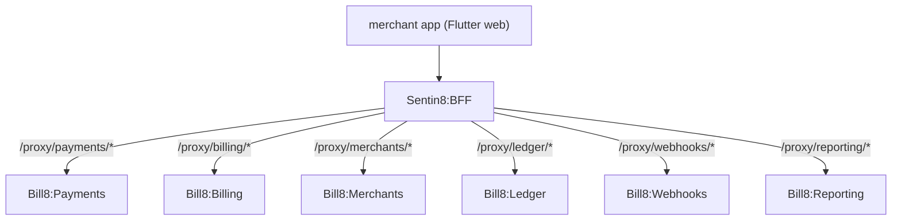

# Bill8:Merchant - Flutter App

The merchant dashboard: accept payments, manage subscriptions, onboard
sellers, and run reports.

## 1. Summary

Bill8:Merchant is the operator-facing Flutter app for the bill8
vertical. It renders the merchant's payments, billing, connected-account,
and reporting surfaces as a single dashboard, routing every call through
the BFF proxy.

## 2. Motivation

A merchant needs one place to manage revenue without building their own
dashboard. This app composes the vertical's service surfaces into a
consistent, design-system-aligned experience.

## 3. Architecture & High-Level Design

## 4. Key Traits and Data Structures

- `Bff8ApiClient` - the shared BFF client (no direct backend calls).
- Feature modules per surface (payments, subscriptions, reports,
  connected accounts, webhooks).

## 5. Rationale, Trade-offs, and Alternatives

- **BFF proxy only** - no app calls a service directly; tokens stay
  server-side.

## 6. Internal Implementation & Invariants

- All calls route through `Bff8ApiClient`; no direct HTTP to services.

## 7. Unresolved Questions / Future Designs

- See the vertical `backlog.md`.

---

**Design attribution:** bill8:merchant and its underlying concepts were designed by Hamid Jahanzad <Hamid@Jahanzad.com>.
